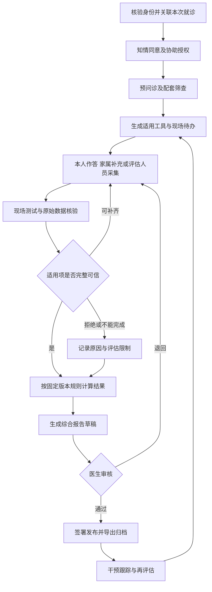
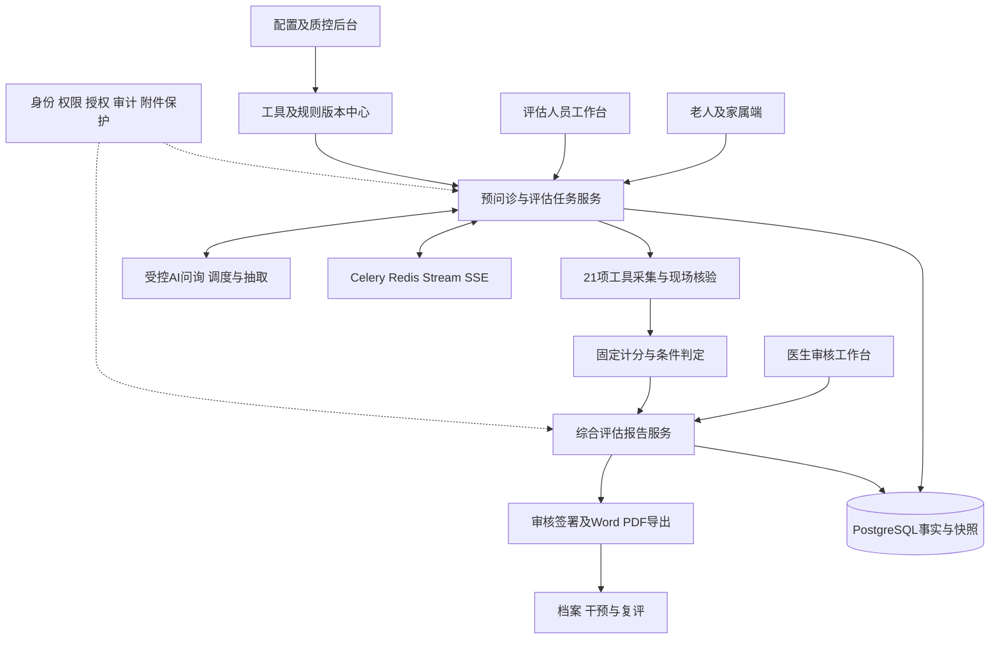

# 老年预问诊与综合评估系统项目构想总需求

版本：V1.0  
编制日期：2026年10月21日  
建设基础：`medical-evaluate-main` 模板项目  
核心交付：21项老年评估工具的规范采集，以及经医务人员审核的老年综合评估报告。

## 1 项目定位与编制依据

本项目面向有综合评估需求的60岁及以上老年人，以就医前和候诊期间的预问诊为入口，将老人自述、家属补充、现场测试、量表计分、人工复核和综合报告串联起来。系统帮助老人减少重复填写，帮助评估人员获得完整可信的数据，帮助医生掌握多维问题并制定干预计划。

本文件结合前期已经确认的业务范围及用户提供的《量表评估国家标准.pdf》编写。该附件内容为WS/T 888—2026《医疗机构老年综合评估技术操作标准》；本项目中的“21张量表”具体指其附录B的B.1至B.21共21项工具，包含量表、问卷、操作试验及诊断标准。附录A、正文筛查问题和其他必要测量属于配套信息，不计入21项。

本次参考模板的实际代码根目录为压缩包内的 `medical-evaluate-main/medical-evaluate-main/`。主要参考材料如下，路径均相对于该代码根目录：

| 材料 | 本项目的使用方式 |
| --- | --- |
| `docs/项目构想总需求.md` | 参考需求组织方式和人机协同思路；将住院护理定位调整为老年预问诊与综合评估 |
| `AGENTS.md`、`backend/AGENTS.md`、`frontend/AGENTS.md` | 参考工程分层、目录、接口及开发约定；结合新业务修订，不机械照搬历史约定 |
| `backend/app/models/`、`backend/app/api/`、`backend/app/services/` | 核对已有患者、就诊、任务、量表、提交、答案与复核模型及服务入口 |
| `frontend/package.json`、`backend/pyproject.toml` | 核对模板的技术栈和检查命令，不代表要求升级至最新版本 |
| `docs/structured/assessment-scales/` | 参考现有量表结构化方式；原有5类表单不能代替本项目21项工具 |

本次为静态资料和代码审阅，未启动模板、连接数据库或运行真实模型，因此“可复用基础”不等于已完成联调和验收。压缩包内的历史计划、提示词及工程说明是参考资料，不改变用户已经确认的项目目标。

## 2 模板基础与改造差距

| 领域 | 模板中可见的基础 | 本项目需要完成的改造 |
| --- | --- | --- |
| 用户端 | 患者端及医护端，传统问卷与AI交互入口 | 老年适老化交互、授权协助、现场评估与医生审核分工 |
| 就诊与登录 | `patient_encounter` 及患者服务以住院记录、在院状态为核心 | 增加门诊或评估就诊上下文，调整登录授权，不能要求门诊老人先有在院记录 |
| 量表配置 | 量表、版本、题目、选项、规则及结构化导入模型 | 建立B.1至B.21独立目录、来源映射、临床确认与发布机制 |
| 计分 | 问卷服务存在选项分数求和及总分比较能力 | 增加条件组合、操作试验、互选、非评分工具和缺失处理，不能全部套用求和 |
| 人机协同 | 患者提交、AI抽取、护士复核、最终提交及证据基础 | 加入来源区分、现场确认、医生综合审核及报告签署权限 |
| AI与实时交互 | Dialog、Schedule、Extraction分工；Celery、Redis Stream、SSE及语音网关代码 | 限制AI采集范围，保证模型不可用时人工或传统问卷流程仍能完成 |
| 报告 | 结果查看、患者画像及护理计划服务基础 | 建设综合评估报告模板、快照、审核、修订、Word/PDF导出和归档；不能将护理计划视为完整报告 |
| 配置管理 | Demo配置接口可直接编辑已有记录 | 增加待审、审批、发布、停用及历史版本保护，正式环境不采用修改即生效 |

其中，模板 `docs/structured/assessment-scales/assessment-scales-review.md` 的NRS2002初筛BMI及年龄加分边界，与本项目附件B.18存在差异。应按来源分别建版本，禁止将模板中的 `nrs2002` 名称相同视为规则相同，也不得直接覆盖旧任务。

## 3 目标与范围

### 3.1 建设目标

1. 完整支持21项工具的配置、采集、保存、核验、结果表达和报告引用。
2. 将适合自述的信息前移至院前或候诊采集，现场完成需要人员、设备及安全环境的测试。
3. 让每项答案、测量、评分及判定可追溯到工具版本、来源、操作者、时间和证据。
4. 形成包含评估结果、数据限制及干预计划的报告草稿，经医生审核后发布和归档。
5. 对不会使用手机、视听能力下降、需要家属协助和不能完成部分测试的老人提供可执行路径。

“全部支持21项”是平台能力要求；“单次适用任务完成”是个体评估要求。筛查阴性、工具互选或明确不适用的项目可以不执行，但必须记录依据，不将跳过显示为正常。

### 3.2 必须交付的范围

患者与就诊管理、知情同意及协助记录、预问诊信息采集、21项工具库、筛查与任务编排、现场测试记录、版本化计分与判定、人工补录和复核、综合报告、权限及审计、报告导出和归档。

传统问卷和工作人员录入是可独立运行的采集路径。AI文本及语音在模板基础上按验证结果接入，不得成为完成21项工具与报告的唯一前提。基本复评记录和历史报告保留属于核心闭环，自动随访和高级统计可后续增强。

### 3.3 扩展及边界

- 正文引用的认知深入评估、抑郁、焦虑、社会支持、跌倒风险及吞咽筛查等外部工具不属于附录B的21项。首版需记录相关筛查及后续待办，未接入的工具和未完成领域在报告中明确列出。
- 附录B的21项全部完成，不自动等于标准全部领域已经完成。若机构要求提供完整标准范围的综合评估，应将所采用的外部工具及必要流程纳入交付。
- 多重用药信息、肌少症相关测量及附录A信息按临床选定范围采集，不用新增虚构“量表”凑数。
- 模板的完整知情同意语音宣讲、Teach-back、住院宣教、科研分析等保留为扩展能力，不作为本项目首版必交内容；评估本身的知情同意与来源记录仍为必需。
- 系统不独立作出临床诊断、开具处方、调整用药或自动批准治疗方案。专业测试与临床结论由具备相应资质的医务人员确认。

## 4 用户与痛点

| 角色或环节 | 主要痛点 | 项目响应 |
| --- | --- | --- |
| 老人进入服务 | 扫码和登录步骤复杂，无设备或不会操作 | 简化入口、院内设备及工作人员协助，不以拥有智能手机为前提 |
| 老人阅读作答 | 字体小、长句多、术语难懂、视听能力下降 | 大字高对比、单题显示、播报与放大，解释绑定原题且不改变评分含义 |
| 病史与用药回忆 | 病种和药品多，时间线及剂量不清楚 | 分主题引导，保留“不知道”待核验状态，允许提供药盒等证据 |
| 家属协助 | 代理回答与老人自述混淆 | 记录关系、授权、回答来源及冲突，不让家属代做认知等专业测试 |
| 连续填写 | 疲劳、叫号、断网导致中断 | 自动保存、续填、分阶段采集、明确当前待办 |
| 敏感问题 | 漏尿、情绪及家庭情况不愿公开 | 知情说明、私密环境、拒答记录及人工沟通 |
| 评估人员 | 不同工具操作和判定要求不同，易漏项或算错 | 步骤提示、单位校验、条件路径、确定性规则及核验清单 |
| 医生 | 只有分数，没有来源、缺项或干预线索 | 多维摘要、证据追溯、待完成项和报告审核 |
| 质控人员 | 版本和结果修改不透明 | 规则审批、版本锁定、修改留痕和导出审计 |

以上为场景分析，未提供实际访谈或耗时统计，不将其写为已验证的实地调研结论。

## 5 核心业务流程



知情同意未获得时停止临床采集，不将评估任务自动标记为完成。测试中不适、急性异常或需要即时处理的情况转入机构既有人工医疗流程，暂停相应测试并记录处理情况。

## 6 21项工具采集与结果规划

工具代码 `cga_b01` 至 `cga_b21` 为建议新增标识，需在导入映射中与模板旧代码区分；不是现有API或已经建库的承诺。

| 编号 | 工具名称 | 主要采集方式 | 结果与关键约束 |
| --- | --- | --- | --- |
| B.1 | 基本日常生活活动能力评估量表 | 本人或照顾者陈述，专业核验 | 10项、0～100分及依赖程度 |
| B.2 | 工具性日常生活活动能力量表 | 最近1个月实际表现采集 | 8项、0～8分及依赖程度 |
| B.3 | 简易体能状况量表 | 运动筛查阳性后现场测试 | 平衡、4米步速、5次起坐，0～12分；保留重复测量及取值依据 |
| B.4 | 视力简易评估表 | 陈述与核验 | 0～4分；记录佩戴眼镜条件 |
| B.5 | 视觉功能简易评估表 | 陈述与核验 | 3项、0～3分，保留异常条目 |
| B.6 | 听力简易评估表 | 陈述与核验 | 0～4分；记录助听器情况，与B.7按场景选择 |
| B.7 | 耳语试验 | 评估人员现场操作 | 双耳各自结果及筛查判定，不虚构总分 |
| B.8 | 简易智力评估量表 | 老人本人现场回忆及画钟 | 0～5分；保存画钟证据，禁止家属替答 |
| B.9 | 居家环境筛查表 | 老人或了解环境的照顾者提供信息 | 14项、0～14分，越低环境风险越大；不自造分级阈值 |
| B.10 | FRAIL量表 | 陈述并核验疾病及体重信息 | 按满足条目数判断，保留原始依据 |
| B.11 | 尿失禁问卷表 简表 | 尿失禁筛查阳性后采集 | 最近4周；前三项0～21分，发生情境另存，不混入总分 |
| B.12 | 便秘症状评估表 | 症状及时间采集，医务人员判断 | 症状摘要与判断结果，不虚构分数 |
| B.13 | 阿森斯失眠量表 | 睡眠筛查阳性后自述 | 8项、0～24分；6分分类歧义须先确认 |
| B.14 | 慢性疼痛数字评定量表 | 慢性疼痛筛查阳性且能自评 | 0～10分及对应结果 |
| B.15 | 慢性疼痛行为评估量表 | 无法自评时专业观察 | 条目1、2及3或4合计3～12分，第3和第4项不能同时累计 |
| B.16 | 压力性损伤风险评估量表 | 筛查阳性后现场评估 | 6～23分及标准有明确规定的风险分级 |
| B.17 | 洼田饮水试验 | 吞咽筛查后，由专业人员判断可否安全测试 | 保存时间、次数、呛咳等；同为1级也需区分时间对应的结果 |
| B.18 | 2002营养风险筛查量表 | 按场景选择，含初筛和终筛 | 初筛决定是否进入终筛；终筛含年龄加分；不拆成两张量表计数 |
| B.19 | 微营养评定法 简表 | 按场景选择并核验测量 | 0～14分；无法获得BMI时用小腿围，不能重复计分 |
| B.20 | 全球领导人营养不良倡议标准及分级标准 | 营养筛查阳性后专业评估 | 表现型与病因型组合及严重程度；多个子表属同一工具；结论需医生确认 |
| B.21 | 谵妄 意识模糊评估 | 专业观察并结合基线 | 按条目1及2阳性、且3或4阳性的逻辑提示，医务人员确认 |

### 6.1 工具配置字段

每个工具至少配置标准编号、名称、来源条款、适用范围、采集角色、回顾时间窗、测试条件、分组、条目、选项、字段类型、合法值、单位、是否必填、是否派生、条件分支、计分方法、结果表达和临床确认状态。工具配置、规则及解释共同版本化，不仅版本化页面标题。

### 6.2 规则控制

1. 采用受限规则定义或明确实现的规则处理器，覆盖求和、分支、互选、测量映射、条件组合和人工判断；不执行任意代码表达式。
2. 缺失、不知道、拒绝、不能完成与有效0值分别存储，不用默认0分完成计分。
3. B.13原附件的4～6分与≥6分区间重叠。确认前保留分数及“分类待核验”，不自动给出唯一解释；确认后记录批准人、依据、时间及新版本。
4. B.3的4米步速与正文肌少症的6米步速分开存储与解释，不混用距离或阈值。
5. 发布前必须核对附件原文、数字和比较边界；同名模板的BMI、年龄、分值及时间窗不能直接继承。
6. 不将21项分值相加为“健康总分”；报告按工具及领域分别表达。

## 7 功能需求与验收关联

| 编号 | 功能需求 | 最低验收条件 |
| --- | --- | --- |
| FR01 | 患者、就诊及授权管理 | 可建立门诊评估任务，区分老人、协助者、评估人员及审核医生，患者不能查看他人记录 |
| FR02 | 预问诊采集 | 主诉、病程、疾病、过敏、用药及照护信息可保存、补录、核验并追溯来源 |
| FR03 | 适老化与续填 | 支持放大、高对比、播报、暂停、服务端续填及人工协助；中断后已保存内容不丢失 |
| FR04 | 筛查及任务编排 | 条件触发、互选、不适用及人工改选均有依据；待现场项目不误计为已完成 |
| FR05 | 全量工具采集 | B.1至B.21逐项演示配置、采集、核验、结果及报告引用，子表不重复计数 |
| FR06 | 现场评估 | 操作步骤、设备或条件、原始测量、证据及不能完成原因可记录；患者端不要求自行做专业测试 |
| FR07 | 固定规则与异常 | 经批准的边界、缺失、互选及组合用例全部匹配人工预期；规则未确认时显示待核验 |
| FR08 | 人工复核 | 原始提交与最终确认分开保留，支持退回补录，修改记录有操作者、原因和时间 |
| FR09 | 综合报告 | 可生成草稿，经医生审核后签署发布，Word/PDF结果一致，未完成领域及限制清晰可见 |
| FR10 | 干预与复评 | 保存医生确认的干预计划、责任人和复评安排，形成新的评估批次而不覆盖旧记录 |
| FR11 | 配置与审计 | 临床审核后发布规则，新任务绑定新版本，历史任务及报告保留原版本，导出和签署可审计 |
| FR12 | AI辅助 | 结构化答案带原始证据和置信信息；模型失败不伪造回答或进度，可转人工或显式切换采集路径 |

## 8 综合评估报告要求

### 8.1 内容

- 身份与评估背景：患者、就诊、评估日期、场景、评估人员、协助者及信息来源。
- 预问诊摘要：主诉、病程、重要疾病、过敏、用药及照护情况。
- 工具结果：名称、版本、适用状态、完成情况、分数或非评分结论、关键证据及待确认项。
- 多维问题：躯体功能、精神心理、社会环境及老年综合征相关发现；未覆盖领域明确标注。
- 数据限制：未触发、不适用、拒绝、不能完成、缺项、信息冲突及可能影响。
- 综合意见与干预计划：问题、目标、措施、责任人、转诊和复评时间，由医生或多学科团队确认。
- 审核与归档信息：报告编号、版本、审核人、签署时间、修订原因及替代关系。

### 8.2 生成与发布

报告按“结构化数据校验 → 固定规则计算 → 草稿生成 → 医生审核 → 签署发布 → 导出归档”流转。护士完成采集复核不自动等于医生签署报告；AI生成的护理计划也不自动成为已批准的干预方案。

有缺项或冲突时先返回核验清单；无法补齐的情形可由医生确认后签署带明确限制的报告，不得自动补全缺失事实。已签署报告保存数据及规则快照；修改后生成新版本，不覆盖旧文件。导出失败可重试，重复请求不得生成重复签署记录。

## 9 数据与状态设计

### 9.1 复用现有领域主链

```text
patient → patient_encounter → care_task
care_task → assessment_instance → assessment_submission → assessment_answer
assessment_answer → assessment_answer_option
assessment_submission → assessment_score
assessment_instance → assessment_review
AI路径：care_task → interaction_session → interaction_message / interaction_event
```

上列名称来源于模板ORM，不沿用旧构想文档中另起一套 `form_templates`、`assessment_sessions` 等概念表名。门诊适配、授权、临床审批、现场证据和报告实体属于新增设计，需通过迁移实现，而不是声称模板已有。

建议增加或扩展：就诊类型及状态、协助授权、原始测量及附件、适用性与原因、规则审批记录、医生审核身份，以及报告主档、版本快照、导出任务和审计记录。最终表名及外键写入数据库设计文档后再迁移。复用 `nursing_plan` 需核实其业务和权限，不能以它直接替代综合报告实体。

### 9.2 状态分层

| 对象 | 目标状态语义 |
| --- | --- |
| 工具执行 | 未开始、进行中、待现场完成、待核验、已完成；未触发、不适用、拒绝、不能完成作为明确结果状态 |
| 采集任务 | 准备中、采集中、待现场或人工补充、待复核、退回补录、评估完成、取消 |
| 报告 | 草稿、待审核、退回、已签署、已被新版替代 |
| 工具与规则版本 | 草稿、待临床确认、已发布、已停用 |

这些是目标业务语义，具体枚举需映射现有 `task_status`、`instance_status` 和 `submission_status`，并提供旧数据迁移。采集进度、人工核验进度、报告签署状态分别展示，不以对话轮数或AI结束语判断最终完成。分母随适用路径确定；被跳过项目显示原因，不伪装为已答。

## 10 AI职责与技术架构

### 10.1 业务智能体分工

| 组件 | 可承担的职责 | 必须遵守的限制 |
| --- | --- | --- |
| Dialog | 沟通说明、受控问询、解释、暂停及转人工 | 原题和时间窗可追溯，不能指导无人监督的专业测试 |
| Schedule | 维护待采集项、提出追问和路径建议 | 临床适用性、互选及完成条件最终由服务端规则校验 |
| Extraction | 从陈述提取候选结构化答案 | 保留消息证据及可信度，不把推断当测量结果，不修改最终确认提交 |
| 摘要或计划辅助 | 整理已核验事实，形成报告文字或计划草案 | 不负责计分，不自行诊断、调整用药或签署报告 |

保留模板中的应用层与 `medagent` 分离：应用层装配数据库、权限、事件和工具执行依赖，SDK不反向导入 `app.*`。固定计分及报告发布控制位于业务服务，不能仅依赖提示词约束。

### 10.2 功能结构图



### 10.3 延续模板的技术选型

- 前端：Next.js App Router、React、TypeScript、Tailwind CSS、Zustand；沿用Repository隔离Mock/API，不让页面直接耦合传输层。
- 后端：Python 3.11、FastAPI、Pydantic、SQLAlchemy、Alembic、PostgreSQL。
- 异步与实时：Celery、Redis、Redis Stream、SSE；语音通过后端WebSocket网关访问供应商。
- 模型：沿用配置驱动的语言及语音绑定，不在前端或代码中硬编码供应商密钥。
- 报告：新增模板化Word/PDF生成与受保护文件下载服务；引入依赖前核实许可证、字体、部署和资源消耗。

具体依赖以模板锁文件为准。现有接口以 `backend/app/api/` 为事实来源；门诊、授权、现场采集、规则审批和报告接口属于待设计范围，需同步DTO、权限和前端Repository，不将建议路径写为已存在接口。

## 11 质量、安全与运行要求

1. 适老性：支持390px移动视口，文字可放大、按钮易点击、状态清楚；评估需现场协助时提供明确入口。
2. 正确性：21项工具逐项经过临床及规则核对，典型值、阈值边界、缺失、互选及非评分用例覆盖完整。
3. 可靠性：断网续填、SSE重连和任务重试不重复记录；PostgreSQL为长期业务事实来源，Redis用于运行态和传输。
4. 权限：老人仅访问本人任务；家属按授权范围；评估人员按职责；医生有报告审核权限；配置及导出操作受限并审计。
5. 隐私：身份信息、答案、录音、签名和图片受保护；不将患者明文、密钥及完整对话写入普通日志或Git；模型数据传输按机构政策配置。
6. 可追溯：工具、原始证据、规则、提交、复核和报告版本可关联；规则更新不修改历史签署报告。
7. 性能：试点前定义网络、设备、并发和样本规模，再确定响应及生成目标；不将模板演示性能当作生产指标。
8. 部署：沿用模板的同源HTTPS代理、SSE及WebSocket转发方案；数据库和Redis不面向公网，生产配置不提交仓库。

## 12 分阶段实施与验收

### 12.1 实施顺序

- 阶段A：核实21项工具与临床规则，完成来源映射、门诊就诊及授权设计、数据迁移设计和验收样例。
- 阶段B：实现传统问卷、人工录入、现场测试及任务路径，打通全部21项的采集与复核。
- 阶段C：实现报告草稿、医生审核、签署、修订、Word/PDF导出、权限及归档。B和C共同形成首版完整交付。
- 阶段D：在核心闭环可运行基础上完善AI问询、语音、历史对比及质控；不因模型联调受阻缩减21项及报告范围。

### 12.2 必验场景

| 验收编号 | 场景 | 通过标准 |
| --- | --- | --- |
| AC01 | 逐项执行21项工具 | 每项可采集、保存、核验并在报告正确表达，不以配置文件存在代替功能可用 |
| AC02 | 老人自填与家属协助 | 来源、授权及操作者完整，认知任务不允许代理作答 |
| AC03 | 条件与互选 | B.15的3/4项、B.19的BMI/小腿围、B.18初终筛及其他路径计分正确 |
| AC04 | 非评分与组合 | B.12不出现虚构总分；B.20和B.21按条件及人工确认表达 |
| AC05 | 边界及来源差异 | NRS2002来源版本隔离；B.13的6分有已批准口径或明确待核验提示 |
| AC06 | 缺失与不能完成 | 不默认0分或正常；限制带入报告；需要医生确认的例外不能由患者自行跳过 |
| AC07 | 报告完整流程 | 草稿、退回、补录、医生签署、下载、归档及修订可追溯；Word/PDF内容一致 |
| AC08 | 中断及重复请求 | 断网恢复不丢已保存数据，重复提交、导出和后台重试不产生重复业务记录 |
| AC09 | 权限隔离 | 患者越权、代理越权及无审核权签署被拒绝；附件不能匿名访问 |
| AC10 | 模型不可用 | 任务不伪装完成，有明确失败及转人工路径，传统采集和人工审核可继续 |
| AC11 | 门诊场景 | 无在院记录的合格患者可在授权后进入正确的本次评估，不能靠伪造住院记录绕过 |

### 12.3 交付物

需求与功能图、21项来源及规则字典、前后端功能、必要数据库迁移、临床确认记录、报告模板、导出文件样例、规则及流程测试记录、操作说明和部署配置说明。

## 13 待机构确认的配置项

机构和评估场景、可接受的身份核验方式、代理授权流程、现场测试人员与设备、规则确认责任人、报告审核及签署方式、外部工具覆盖范围、档案保存制度、现有系统接口、试点规模和性能目标。

这些事项应有明确配置或待确认记录；不会阻止非依赖部分的建设，也不能由模型擅自确定临床阈值、签署身份或数据保存期限。
